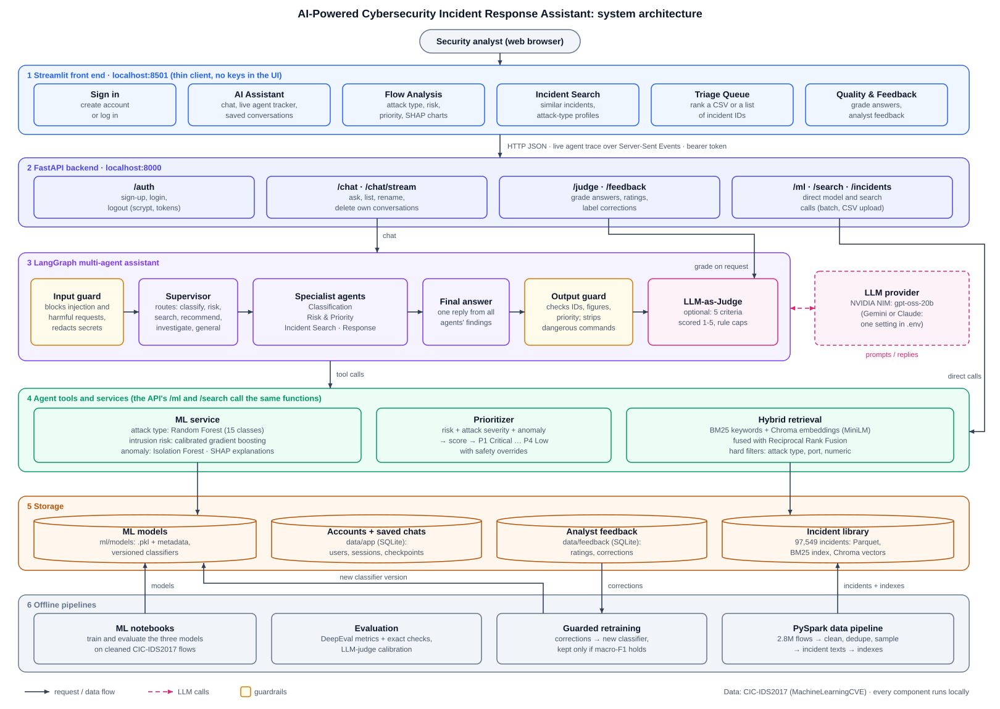
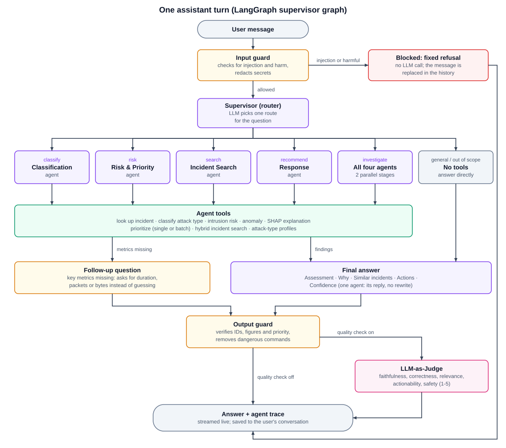

# Architecture

Two diagrams describe the system: the overall architecture, and the path of one question through
the multi-agent assistant. Both are drawn by
[`diagrams/render_diagrams.py`](diagrams/render_diagrams.py) as SVG (documents, GitHub) and PNG
(slides). Edit the script and run `python docs/diagrams/render_diagrams.py` to update them.

| Diagram | SVG | PNG |
|---|---|---|
| System architecture | [architecture.svg](diagrams/architecture.svg) | [architecture.png](diagrams/architecture.png) |
| One assistant turn | [agent_workflow.svg](diagrams/agent_workflow.svg) | [agent_workflow.png](diagrams/agent_workflow.png) |

---

## System architecture

The system is layered. Each layer only calls the one below it, and everything runs locally except
the LLM provider.

1. **Streamlit front end** (`frontend/`). A thin client: every page calls the API over HTTP, so
   no model, agent or API key lives in the UI process. The sign-in page gates the app; the token
   from `/auth/login` is kept in the Streamlit session and sent with every request.
2. **FastAPI backend** (`src/api/`).
   - `/auth`: accounts.
   - `/chat` and `/chat/stream`: the assistant. The stream sends each agent step as a Server-Sent
     Event, so the UI can show live progress.
   - `/judge` and `/feedback`: quality and analyst feedback.
   - `/ml` and `/search`: direct model and search calls, which use the same functions as the agent
     tools so both always agree.

   Conversation endpoints check that the signed-in user owns the conversation.
3. **LangGraph assistant** (`src/agents/`). An input guard, a supervisor that routes the question,
   four specialist agents, a final-answer node, an output guard and an optional LLM judge. The LLM
   is a configuration choice (NVIDIA NIM, Gemini or Claude).
4. **Tools and services** (`src/services/`, `src/retrieval/`).
   - the ML service: attack-type classifier, intrusion-risk model, anomaly detector and SHAP
     explanations
   - the prioritiser
   - hybrid retrieval: BM25 and Chroma, fused with Reciprocal Rank Fusion, behind hard filters

   Tools never raise: errors come back as data the agent can act on, and the API maps them to HTTP
   status codes.
5. **Storage.**
   - ML models (with versioned retrained classifiers)
   - the incident library: Parquet, BM25 and Chroma
   - accounts and saved conversations: SQLite, holding the LangGraph checkpoints
   - analyst feedback: SQLite
6. **Offline pipelines.**
   - PySpark builds the incident library from 2.8 million raw flows.
   - Notebooks train the models.
   - Guarded retraining turns analyst corrections into a new classifier, which is activated only
     if macro-F1 does not drop.
   - The evaluation suite (DeepEval, exact checks, judge calibration) measures the assistant.

## One assistant turn

- The **input guard** runs before any LLM call. Injection attempts and requests to build attacks
  get a fixed refusal and are replaced in the conversation history, so they can't influence later
  turns. Secrets are redacted.
- The **supervisor** chooses one route; only the agents that route needs are run. A classification
  question costs about 3 LLM calls; a full investigation about 10–15, with Classification and
  Risk & Priority running in parallel, then Incident Search and Response.
- **Agents** call tools and write findings into the shared state. If the key metrics of a flow
  are missing, the turn ends with a follow-up question instead of a guess.
- The **final answer** is written once, from all findings.
- The **output guard** verifies the answer against the tool evidence and fixes or annotates it
  (unverified IDs, contradicted figures or priorities, dangerous commands, missing caveats).
- The **LLM judge** (on request) scores the answer 1–5 on five criteria. Rule-based caps stop it
  from passing facts that rules can disprove.
- Every step emits a trace event. The front end shows them live, and the conversation (with its
  findings and evidence) is saved for the signed-in user.

See [IMPLEMENTATION_SUMMARY.md](IMPLEMENTATION_SUMMARY.md) for the details of each component and
the design decisions behind them.
